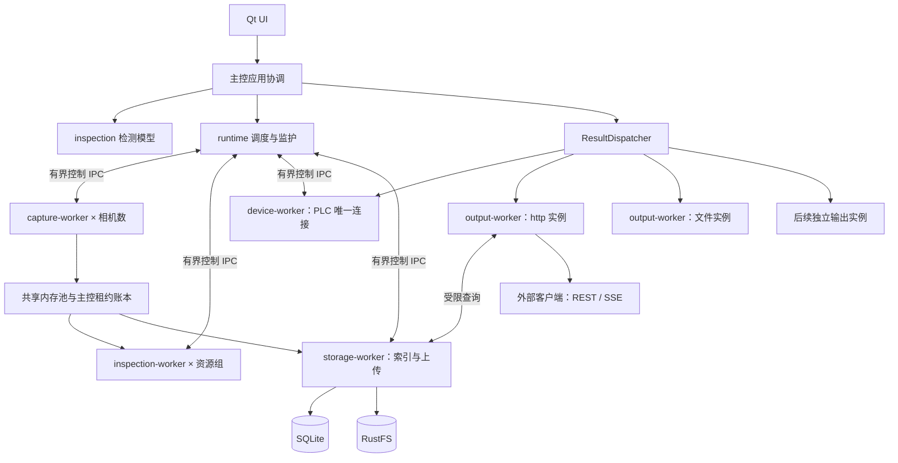

# 工业视觉检测上位机开源框架——开发计划及要求

版本：0.15  
整理日期：2026-09-18  
状态：开发实施计划；已推进T22～T27批次的软件实现，父任务验收条件不变；实际完成状态与最终证据以开发进度台账为准。整体生产能力尚未实现。  
适用对象：框架开发者、插件开发者、AI 编程助手、测试与集成人员。

2026-10-10 OpenCV 增量：增加 `plugins/algorithm/opencv` 可选 Algorithm，
首批实现阈值/形态学、连通域筛选、像素轴对齐尺寸与固定尺度角度模板定位。
复用 Algorithm ABI、只读共享图像租约、标准 evidence 和独立 worker-host；
OpenCV 不进入 runtime/contracts/UI 依赖。默认关闭，不切换现有 GUI 算法。
必须验证确定性几何、格式/ROI/资源边界、实际 DLL/工位流程与故障隔离，
然后完整 windows-all 回归。配置见[OpenCV说明](plugins/algorithm/opencv/README.md)。
HALCON、毫米标定、复杂轮廓/旋转尺度匹配及现场精度不属于此增量；
world 实际内嵌组件及许可包装作为发布门槛，不凭 find_package 组件列表缩小许可范围。
父任务和 Production 准入要求不降低。

2026-10-10 外部数据库增量：增加可选 MySQL/PostgreSQL ResultOutput，
按 `plugins/database/<协议>-output` 组织，客户端仅链接插件及验收程序，
不增加 QtSql 或主控数据库调用。复用独立宿主、交付账本、期限和持久 agent；
显式迁移、环境变量凭据、参数化事务、事件幂等与身份冲突校验、严格 TLS。
外部数据库是交付目标，不替代本地 SQLite 权威账本。
配置及当前边界见[数据库说明](plugins/database/README.md)，
软件验收见[VAL-031](docs/acceptance/VAL-20261010-031-数据库输出插件.md)。
该增量不关闭 T24/T27 或 E03 的生产恢复、现场与长稳验收。

本文将已有讨论和《架构设计.md》落实为开发边界、模块功能、数据契约、任务顺序和验收要求。本文中的接口名称、目录和配置是开发目标，不表示对应文件或能力已经存在。

2026-10-09 设备接入增量：按已批准范围增加可选海康 MVS 和 Snap7/S7 插件，补强 Modbus。
详见[实施卡](docs/tasks/T22-T23-海康S7与Modbus接入.md)及[配置、握手与部署](docs/tasks/T22-T23-deployment.md)。
SDK 与协议依赖限定在插件中，复用现有 Camera/Communication ABI 和独立宿主。
软件对端与实机验收分开，T22/T23 的实拍、物理断线、动作关联和现场要求保持不变。

2026-09-20 开发辅助Skill首版：见[S01实施卡](docs/tasks/S01-Agent开发Skill.md)、
[使用指南](docs/Skill开发使用指南.md)和[VAL-027](docs/acceptance/VAL-20260920-027-Agent开发Skill.md)。
提供源码扩展接入、模拟应用/输出插件模板、Agent工作流和可执行验证。该增量不减少T24～T32验收要求，
不等于完成正式SDK分发、现场生产能力或跨平台验证。

2026-09-20 原图归档联接：见[实施卡](docs/tasks/T24-图像租约归档.md)和[VAL-026](docs/acceptance/VAL-20260919-026-图像租约归档.md)。
GUI持久模拟已接入双相机正式租约→独立进程本地Flush→算法→结果确认，保存有效配方快照并提供trace查询。
本地归档不代表远端上传完成；分割掩码、自动上传/对账、完整恢复事件及常驻生产编排继续待完成。

2026-09-19 持久模拟联接及异常重启复核：见[实施卡](docs/tasks/T24-T27-持久模拟联接.md)
和[VAL-025](docs/acceptance/VAL-20260919-025-重启复核与持久模拟.md)。结果先持久确认再回报模拟PLC，
结束时独立清算文件输出；GUI可操作启停及查看状态。Failed/Expired不能因Pending归零而报告成功。
该次验收时图像租约落盘仍未完成；后续本地归档见上方VAL-026。生产持续调度、现场硬件与对账验收保持未完成。

2026-09-19 T22～T27批次：见[任务卡](docs/tasks/T22-T27-实施批次.md)、
[持久存储与输出](docs/protocols/持久存储与输出-v1.md)、
[HTTP实际契约](docs/protocols/HTTP输出-v1.md)及[Modbus寄存器](docs/protocols/Modbus寄存器-v1.md)。
已增加Modbus软件适配、SQLite事务/交付租约、暂存及RustFS续传、JSONL/CSV、HTTP和生产准入检查。
SDK下载受阻与真实硬件缺失保持显式阻塞；该批次后T24剩余全量追溯/对账和T27常驻生产编排
仍需按本计划完成。下方原始要求不因已有局部实现而降低。

2026-09-19 T16～T21批次：见[实施卡](docs/tasks/T16-T21-实施批次.md)、
[掩码契约](docs/tasks/T19-掩码契约.md)、[回放资产](docs/tasks/T21-回放资产.md)及
[实际支持的模型契约](docs/protocols/ONNX模型与离线回放-v1.md)。
首批CPU模型采用原创输入相关ONNX样例与独立参考；“YOLO样例方向”落实为
明确无objectness的检测/分割张量契约，不冒充已验收第三方训练YOLO模型。
T20首版支持二进制PNM图像、阈值/ROI及模型配置试运行；完整低代码、通用配方可视编辑、
其他图像格式不在此批次。T21为显式本地资产包回放，数据库历史查询与RustFS读取仍待T24。
本地掩码为local_ephemeral，生命周期属于会话；不能标记为Durable。

2026-09-19批次修订：实施见[T11～T16任务卡](docs/tasks/T11-T16-实施批次.md)。
[ADR-011](docs/decisions/ADR-011-算法图像移交.md)规定只读图像移交；
[ADR-012](docs/decisions/ADR-012-恢复与可靠分发边界.md)关闭A04/A06设计项，
规定权威结果与分发intent的生产事务边界，以及旧Running/图片Pending/PLC Unknown恢复矩阵。
T12单在途Demo工位，T13模拟协议，T14内存Volatile outbox；T24仍负责真实数据库事务和F26磁盘故障。
新增InspectTask/DeviceTask/DeviceFinished/DeliveryTask/DeliveryFinished，
握手必须支持capture-v1、inspect-v1、device-v1、delivery-v1，同批二进制成套升级。
Qt依赖仍限既有Core/Network/Gui/Widgets动态链接，未新增商业模块。

“必须”表示验收要求；“默认”表示本计划选定、可以通过设计决策记录调整的实现路线；“后续”表示不计入首版完成条件。不得用空接口、模拟返回或仅写配置文件冒充真实功能完成。

---

## 1. 怎么使用这份文档

1. 先读第 2～5 章，明确产品范围、运行边界与代码依赖。
2. 实现前阅读第 6～9 章，固定身份、状态、IPC、图像所有权和插件契约。
3. 按第 10～18 章实现具体模块，遵守其输入输出和异常规则。
4. 按第 21 章的任务依赖逐步开发，每个任务使用第 22 章的 AI 工作流程。
5. 按第 19～20 章验证功能和故障行为，最后完成第 23 章的发布清单。

不要把整份文档一次交给 AI，要求“一次生成完整工程”。应按任务编号逐项交付；涉及跨模块接口时先完成契约，再实现调用双方。

### 1.1 与已有文档的关系

| 文档 | 用途 |
|---|---|
| 《架构设计.md》 | 说明整体架构与设计理由 |
| 《开发计划及要求.md》 | 本文；规定后续如何实现和验收 |
| 《框架优势与开发方式对比.md》 | 帮助 Java/Web 和普通桌面开发者理解工业场景 |
| 《与VisionMaster的对比分析.md》 | 明确商业视觉平台与本框架的范围差异 |
| 《与OpenVisionForge的架构对比.md》 | 借鉴参数、数据、执行和工具组织方式 |
| 《vision-station与vissync-mes结构审阅.md》 | 将已有项目的经验和风险转换为验收案例 |

本文对旧文档作出的具体化决定集中写在第 3.2 节。实现中发现冲突时，应更新决策和相关文档，不能让 AI 自行混合两种方案。

### 1.2 完成状态必须有证据

统一使用：`未开始 / 进行中 / 待验证 / 已完成 / 被阻塞`。

- “已完成”必须有对应代码、真实入口、测试或验收记录。
- 模拟通过只标记模拟能力通过。
- 真实相机、PLC、GPU、RustFS 均按实际验证环境记录。
- 未执行的测试写明未执行及原因，不写“应该通过”。
- 本文所有开发任务初始均为“未开始”。

## 2. 项目到底要做什么

### 2.1 产品定义

建设一个以 C++ 为核心、Qt 为当前默认桌面技术的开源工业视觉检测框架。使用者通过配置配方、接入设备和开发插件，完成：

```text
现场触发 → 关联工件 → 采集图像 → 执行检查 → 汇总权威结果
                                             ├─ PLC 结果交付
                                             ├─ SQLite 元数据 + RustFS 图像
                                             └─ HTTP / 文件 / 后续 MQTT 等输出
```

框架首先解决工件检测闭环、故障隔离、资源有界、追溯和可扩展性；首版提供基础操作界面，不建设完整低代码视觉平台。

### 2.2 首版必须交付

| 编号 | 能力 | 完成标准摘要 |
|---|---|---|
| R01 | 多进程运行基础 | 主控可以识别、结束并有限恢复故障工作进程 |
| R02 | 工件检测模型 | 工件、检查项、任务、配方、图像和结果可关联，不串件 |
| R03 | 模拟与离线模式 | 无相机、无 GPU、无商业 SDK 可以运行完整演示 |
| R04 | 插件宿主与开发 SDK | 相机、算法、存储、通信、输出扩展具有明确契约 |
| R05 | 有界图像数据通路 | 共享内存、显式租约、队列上限及退出回收 |
| R06 | ONNX 常用推理 | 目标检测、分类、实例分割；默认目标检测 |
| R07 | 一个真实工业相机适配 | 默认优先评估海康机器人 MVS，具体型号及版本接入前确认 |
| R08 | 一种真实 PLC 协议 | 默认候选 Modbus TCP，现场不支持时通过决策记录替换 |
| R09 | 双相机检查汇总 | 两个必需检查项按正确工件归属完成汇总 |
| R10 | 追溯与图像存储 | SQLite 索引、RustFS/S3、有限暂存、失败恢复与对账 |
| R11 | 多路结果输出 | HTTP、PLC 结果、JSONL/CSV；独立交付状态 |
| R12 | HTTP 后端 | 查询、SSE、授权图像访问；不包含外部网页 |
| R13 | 操作与诊断 UI | 启停、配方、模型校验、图像、报警、工作进程和队列状态 |
| R14 | 稳定性验证 | 超时、卡死、崩溃、断网、过载、旧消息和磁盘满测试 |
| R15 | 开源可用性 | 构建、模拟包、示例、插件模板、依赖清单、兼容清单 |

ONNX 三类任务、RustFS 和首批输出都属于首版范围，可以分阶段实现，不能在最终交付中悄悄降为“预留接口”。

### 2.3 首版不做，保留扩展位置

- 完整拖拽流程编辑器、脚本平台和大型算法商城。
- 模型训练、标注平台、任意 ONNX 模型自动识别与适配。
- 跨机器调度集群、容器编排或高可用主控集群。
- 完整 MES、订单管理、ERP、外部看板前端。
- 所有相机品牌、所有 PLC 协议、全平台硬件驱动保证。
- 3D 全流程、线扫拼接、复杂运动控制及通用标定工具箱。
- 任意工具链的 C++ 插件二进制兼容、运行中热卸载。

MQTT 是首版之后的优先扩展；RabbitMQ、Kafka、Webhook、自定义 TCP、外部数据库、OPC UA、光源及 IO 按实际需求增加。

2026-10-09 扩展按 [ADR-014](docs/decisions/ADR-014-网络输出与对象存储插件闭环.md)
实施 Webhook、可选本机 MQTT 和受限 S3 ObjectStorage 插件。
实现范围与验收见 VAL-029；不代表下述完整扩展目标已全部完成。

### 2.4 三种运行模式

| 模式 | 输入 | 外部副作用 | 结果要求 |
|---|---|---|---|
| Demo | 模拟相机和模拟触发 | 只接模拟 PLC；可使用演示本地存储 | 全程标明模拟，不生成生产统计 |
| Replay | 历史图像、配方与模型快照 | 禁止真实 PLC 动作；输出默认禁用 | 新建回放 ID，保留原检测 ID 引用 |
| Production | 经验证的设备与触发链 | 允许配置内的真实输出 | 启动联锁、追溯、期限和故障策略必须有效 |

不能因为真实 SDK 不存在就自动退回随机结果；生产模式设备缺失必须启动失败并说明原因。

## 3. 技术路线与决策管理

### 3.1 开发默认技术基线

| 项目 | 默认方向 | 实施约束 |
|---|---|---|
| 语言与构建 | C++20、CMake、CTest | 精确编译器和依赖版本在 T01 固定 |
| 桌面 | Qt 6 Widgets | UI 可替换，领域模型与 Qt 控件无关 |
| 首发 | Windows x64 | 按 ADR-004，当前先验收 Windows；Linux 独立后移，跨平台发布前补齐；真实设备支持单独列明 |
| 控制通信 | QLocalSocket / QLocalServer | 实现封包、验证、容量和期限 |
| 图像通信 | 平台共享内存适配 | 由统一租约协议管理，不依赖裸共享计数 |
| 控制消息编码 | 有版本的 UTF-8 JSON | 长度前缀；原始图像与大掩码不放入 JSON |
| 算法 | OpenCV 基础处理 + ONNX Runtime C++ | CPU 必须可用，GPU 作为可选构建和验证项 |
| 索引 | SQLite | 存储进程唯一写入者 |
| 图像对象 | RustFS 目标服务 + S3 客户端适配 | 服务独立部署，实际功能按兼容测试确认 |
| HTTP | 独立输出宿主中的 C++ HTTP 库 | T01 选择并锁定；不得默认引入许可证未核对的模块 |
| 插件加载 | 固定工具链的动态库 + 显式工厂 | 通过 manifest 校验，宿主加载，主控不执行第三方插件 |
| 测试 | 一个固定 C++ 测试框架 + CTest 集成 | T01 选定，不同时引入多个同类框架 |

不在本计划中编造“已选定最新版本”。T01 必须形成依赖锁定清单、下载来源、校验值和最小构建证据。

### 3.2 本计划对已有架构的具体化

1. **通信宿主独立**：真实 PLC 协议默认放入 `device-worker`。比旧方案“可放主控通信线程”更严格，减少现场通信阻塞进入主控的机会。
2. **PLC 唯一连接所有者**：通信插件与 PLC 结果映射插件可以共处一个 `device-worker`；承认共同故障边界。主控仅经 IPC 提交命令。
3. **内核与平台实现分开**：runtime 使用时钟、进程、通道等接口，Qt/Windows/Linux 细节放基础设施。
4. **主控掌握租约账本**：共享内存实际映射由各进程持有，租约分配与回收裁决由主控中的 BufferBroker 负责。
5. **结果元数据生产模式默认必需**：图像按 `none / ng_only / all` 选择，另设 `optional / required` 追溯等级；禁止混成一个“是否存图”开关。
6. **无界面命令行入口用于测试和回放**：它复用应用层，不等于首版承诺 GUI 与生产服务独立部署。
7. **可靠异步输出分阶段**：首版把交付契约和 outbox 能力测试清楚；MQTT/MQ 的真实实现仍后续交付。

上述是本次开发计划采用的默认设计，不是对已运行系统的描述。

### 3.3 必须记录的决策

| 决策 | 默认或候选 | 最迟确定时间 | 未确定时怎么开发 |
|---|---|---|---|
| Qt 是否最终采用 | 已采用 Qt 6.8.3 动态链接基线，见 ADR-001 | A01 已落实 | 领域与 runtime 保持纯 C++ |
| 自有代码许可证 | Apache-2.0 或 MIT 候选 | 公开发布前 | 不擅自发布无依据授权声明 |
| Qt 模块、HTTP/S3 库、依赖管理工具 | ADR-001/003 已采用；cpp-httplib、libcurl、CMake 固定版本/离线 SDK | 设计已确定，各 target 接入时验证 | 不让 AI 每个模块自行选库 |
| 相机型号、MVS 版本、平台 | 尚未指定 | T22 | 模拟相机和契约测试先行 |
| PLC 型号、寄存器及握手协议 | Modbus TCP 候选 | T23 | 使用明确的模拟寄存器表 |
| 目标节拍、工件期限、相机数量 | 模拟范围已冻结，真实产线尚未指定 | 对应数据通路/设备设计前；T30 最终验收 | 使用第 19 章及 ADR-002，真实参数另行校准 |
| RustFS 版本、部署地址及预算 | 尚未指定 | T24 集成前 | S3 假服务用于失败路径测试 |
| 生产存图策略、保留期 | 尚未指定 | 生产配方启用前 | Demo 有明确低容量策略 |
| GUI 关闭后继续运行 | 首版默认不支持 | 如需变更，T01 前优先 | GUI 退出走整机正常停止 |

未决事项只阻塞相关集成或发布，不阻塞纯模型、协议和模拟能力。每项最终决策写入 `docs/decisions/`，包含原因、替代方案、影响和验证结果。

### 3.4 已采用的实施决策（2026-09-18）

- [ADR-001：Qt 与依赖边界](docs/decisions/ADR-001-Qt与依赖边界.md)：Qt 6.8.3，动态链接；白名单 Core/Gui/Widgets/Network，本批只使用前三项。沿用开源许可路线，最终发行履约仍须 T31/T32 核查。
- contracts、inspection、runtime 核心、application、plugin-sdk 公共接口保持纯 C++；Qt 放 UI 和外围适配。当前 CMake 对已实现 contracts/application 执行链接依赖白名单检查。以后增加模块时必须扩展检查。
- C++20、CMake ≥3.25、CTest、固定 doctest 2.5.3；默认离线构建，可显式允许校验哈希的测试依赖下载。已安装 SDK 不等于已接入正式工程。
- [ADR-002：首版模拟设计范围](docs/decisions/ADR-002-首版模拟设计范围.md)：功能与高数据量两个参考配置，均禁止真实设备副作用。它们是后续实现输入，不代表已完成模拟运行器或性能实验。
- 本批交付与验收见 [T01 任务卡](docs/tasks/T01-工程骨架.md)。Windows 骨架已实现；Linux CI 尚未实际运行，T01 保持进行中。A03～A09 仍待落实；本批不声明完成生产协议整改。
- 后续 T01 收尾：依赖决策见 [ADR-003](docs/decisions/ADR-003-依赖选型及获取规则.md)，版本来源见 [制品锁定清单](dependencies/artifacts.lock.json)。Linux 前置检查发现本机 WSL2 无法启动，T01 当前转为被阻塞；以进度台账和 VAL-005 为准，尚未进入 T02。

以上两条 T01/Linux 状态记录保留为实施过程说明，现行门槛已由用户授权调整：[ADR-004](docs/decisions/ADR-004-Windows优先与核心基础范围.md) 采用 Windows 优先，Linux 不再阻塞当前阶段；T01～T04 的实际交付见 [VAL-006](docs/acceptance/VAL-20260918-006-Windows核心基础.md)。T02 v1 的精确范围见 [核心契约](docs/protocols/核心契约-v1.md)，后续 IPC/图像/异步状态协议在对应任务扩展，不声称已实现全部生产协议。

[ADR-005](docs/decisions/ADR-005-组合接纳与早期验证.md) 关闭 A05/A08/A09 的设计修订：组合资源预留、日志/指标/故障测试前移、T08/T24 子任务拆分。A03/A04/A06/A07 的健康、持久投递、重启恢复与控制权设计仍须先于相关生产机制实现。

2026-09-19后续修订：[ADR-007](docs/decisions/ADR-007-监护健康与调度边界.md)关闭A03/A07设计修订，明确控制租约、Windows独占/Job、旧设备会话拒绝接管及任务资源结算。T05缺陷修补、T06/T07基础范围见[VAL-009](docs/acceptance/VAL-20260919-009-监护与调度验收.md)。A04/A06仍待设计，真实PLC/设备控制权待T13/T23验证。

2026-09-19前批：[ADR-009](docs/decisions/ADR-009-模拟采集分步接入与全量回归.md)及[VAL-011](docs/acceptance/VAL-20260919-011-全量复核与模拟采集源.md)落实T10a图源/模拟Camera DLL和全量回归入口；T10b公共宿主采集协议待实施。此前[ADR-008](docs/decisions/ADR-008-共享图像与插件宿主边界.md)冻结Windows共享图像布局/同步和插件基础ABI，T08a/b/c、T09的Algorithm公共宿主见[VAL-010](docs/acceptance/VAL-20260919-010-共享图像与插件宿主验收.md)。Communication/ObjectStorage/ResultOutput仍是类型接口，业务接入按T13/T24/T14推进。

## 4. 运行架构：什么代码在哪执行



HTTP 与存储间可以有经主控授权建立的点对点本地查询通道；主控不代理图像下载，不同步等待查询结果。

### 4.1 进程及线程职责

| 进程 | 默认执行上下文 | 所有者与限制 |
|---|---|---|
| workstation | UI 线程、应用事件线程、非阻塞 IPC 事件循环 | 状态由应用事件线程单写；UI 仅消费快照和提交用例 |
| capture-worker | SDK 所需线程、短回调、有限控制队列 | 默认每相机一个；SDK 要求共宿主时记录范围 |
| inspection-worker | 命令循环、受限执行线程、推理内部线程 | 默认一个模型实例一次执行，压测后才增加并发 |
| device-worker | 协议事件循环、有限命令队列 | 相同 PLC 会话只有一个拥有者 |
| storage-worker | 元数据写入执行单元、受限编码上传、受限查询 | 数据库写入不与网络上传共持一把锁 |
| output-worker | 对应插件的事件循环或受限工作线程 | HTTP 与文件分进程；不同实例也默认分进程 |
| RustFS | 外部服务 | 由部署人员维护，不自动执行破坏性配置或升级 |

主控不得加载相机、ONNX、S3、HTTP 或 PLC 第三方实现 DLL。主控可以读取插件描述文件，真正加载和能力探测由工作宿主完成。

### 4.2 必须承认的限制

- UI 与主控首版同进程，UI 原生崩溃会影响主控。
- 多进程隔离不能消除系统内存、磁盘、CPU、GPU 驱动的共同故障。
- 进程能结束不等于产线能直接恢复，需要重新初始化和工件同步。
- 暂停生产可能是正确的业务动作；不能把它误报为“隔离失败”。
- 软件状态机不替代硬件急停、安全回路和 PLC 的精确物理时序。

## 5. 代码架构与目录

### 5.1 依赖规则

```text
ui → application → inspection
                 → runtime 的接口
                 → application/ports

infrastructure → 实现上述接口
worker-host → plugin-sdk、contracts、ipc
plugins → plugin-sdk、对应第三方库
apps → 负责装配，不放业务规则
```

- `inspection` 不依赖 Qt、SDK、SQL、网络、ONNX 或 runtime。
- `runtime` 不依赖 inspection、产品名称、PLC 地址或相机品牌。
- `contracts` 仅放身份、错误、消息与公共值类型，不成为万能公共库。
- `application` 定义需要的端口；基础设施实现端口，应用不反向包含其具体头文件。
- UI 禁止直接操作插件对象、SQLite 和现场设备。
- 在 CMake target 层落实依赖；仅靠目录命名不算分层完成。

### 5.2 建议目录

```text
开发计划及要求.md
架构设计.md
CMakeLists.txt
CMakePresets.json
cmake/
  dependencies/              依赖获取与锁定
  toolchains/                经验证的工具链
apps/
  workstation/               Qt 主控入口
  vision-cli/                Demo、Replay、诊断入口
  capture-worker/
  inspection-worker/
  device-worker/
  storage-worker/
  output-worker/
src/
  contracts/                 ID、错误、消息、共享值类型
  inspection/                工件、检查项、汇总、领域事件
  runtime/
    scheduling/
    supervision/
    lifecycle/
    resources/
    ports/
  application/
    inspection/
    production/
    recipes/
    result-output/
    ports/
  ipc/
    protocol/
    transport/
    shared-memory/
    leases/
  plugin-sdk/
    camera/
    algorithm/
    communication/
    storage/
    output/
  worker-host/
  infrastructure/
    process/
    clock/
    configuration/
    persistence/
    diagnostics/
  ui/
    views/
    viewmodels/
    image-view/
plugins/
  cameras/simulated/
  cameras/file-replay/
  cameras/hikrobot-mvs/
  algorithms/basic/
  algorithms/onnx/
    inference/
    preprocessing/
    adapters/
    postprocessing/
  communication/simulated-plc/
  communication/modbus-tcp/
  storage/local-demo/
  storage/s3/
  outputs/http/
  outputs/file/
  outputs/plc/
examples/
  single-station/
  dual-camera/
  onnx-detection/
  onnx-classification/
  onnx-segmentation/
schemas/                     协议、配方、manifest、结果 JSON Schema
tests/
  unit/
  contract/
  integration/
  fault/
  hardware/
  fixtures/
tools/                       故障注入、基准、诊断包与依赖检查
docs/
  decisions/
  tasks/
  protocols/
  plugins/
  deployment/
  acceptance/
```

按任务创建实际需要的目录，后续 MQTT/MQ 目录不提前堆空壳。现有 `reference-*` 仓库只是研究材料，不加入构建、发布包或自动测试扫描。

### 5.3 四条架构思维如何落实

| 思维 | 在本项目做什么 | 用什么验证 |
|---|---|---|
| 文件组织 | 相机、算法、监护、领域、UI 各有明确位置 | 新成员能定位“换相机”“改判定”“加输出” |
| 层次分离 | UI → 用例，领域不依赖外部实现 | CMake 依赖检查和纯领域测试 |
| 职责分离 | 相机只采集、runtime 只管执行、领域只判定、输出只交付 | 一个故障修复不需要遍历全系统回调 |
| 领域抽象 | 用 Workpiece、Check、RecipeSnapshot 表达检测含义 | 无 UI、无相机也可验证多检查项汇总 |

领域抽象不再额外建立一个“业务内核进程”。它是 `inspection` 中的结构体、状态和规则，由应用协调调用。相机 SDK 替换主要靠设备接口；领域模型负责保证替换后的数据仍属于正确工件、完成正确检查。

## 6. 数据契约：先定含义，再写模块

### 6.1 身份体系

| 字段 | 创建方 | 含义与规则 |
|---|---|---|
| run_id | 主控 | 每次主控运行新建；不得复用上次运行 ID |
| worker_id | 配置 | 稳定的宿主角色/实例身份 |
| worker_epoch | 监护器 | 每次宿主启动递增或新建唯一值 |
| workpiece_id | 应用协调 | 软件工件身份；与现场编号建立明确映射 |
| external_workpiece_key | PLC/扫码适配 | 可重复的现场编号，不能单独作为永久主键 |
| trigger_id | 触发适配 | 一次触发身份，重复边沿不得创建多个工件 |
| inspection_id | 应用协调 | 一次完整检测实例，全球唯一或运行内组合唯一 |
| check_id | 配方 | 某类检查项的稳定 ID |
| task_id / attempt | runtime | 具体执行任务和计算尝试；尝试变化不创建新工件 |
| frame_id | 采集适配 | 图像身份，关联相机、触发和采集序号 |
| event_id | 应用协调 | 对外事件幂等身份；重发不能重新生成 |
| recipe_hash / model_hash | 配置服务 | 内容哈希，不能只用可变文件路径 |
| pool_id / slot_id / slot_generation | BufferBroker | 图像位置和防旧引用的代次 |
| lease_id | BufferBroker | 特定消费者拥有的一次访问许可 |

结果接纳至少校验 `run_id、worker_epoch、inspection_id、check_id、task_id、attempt`。检查通过后才更新领域状态。

跨进程 JSON 中的 64 位计数、代次和纳秒时间使用十进制字符串，避免 JavaScript 客户端整数精度丢失。内部采用强类型 ID，避免把不同 ID 都作为可互换字符串。

### 6.2 状态必须分开

| 类型 | 状态集合 |
|---|---|
| TaskState | Queued、Running、Succeeded、Failed、Cancelled、TimedOut |
| InspectionState | Pending、Running、Completed、Failed、Cancelled、TimedOut |
| QualityVerdict | Unknown、OK、NG |
| PersistenceState | Pending、Durable、Failed |
| ImageState | NotRequested、Pending、Available、Failed、Deleted |
| DeliveryState | Pending、Accepted、DurablyQueued、TransportConfirmed、BusinessAcked、Failed、Expired、Unknown |

不允许用一个 `success` 代替所有状态。算法执行失败时 `QualityVerdict=Unknown`；现场若选择剔除未完成工件，另记 `Disposition=RejectUninspected`，不能把原始质量改为 NG。

首版汇总采用严格规则：所有必需检查项成功完成后，才给最终 OK/NG；任一必需项失败则本次检测失败或超时且质量 Unknown，即使另一个检查已发现缺陷，也保留其局部 NG 证据。

### 6.3 核心数据对象

| 对象 | 必需内容 |
|---|---|
| RecipeSnapshot | 版本、内容哈希、检查列表、参数、模型、关联规则、期限、存储和输出策略 |
| InspectionContext | 工件、工位、产线、触发、模式、配方快照；可选工单、班次、操作员 |
| CaptureRequirement | 相机、触发方式、帧数、序号、格式要求、采集期限 |
| FrameDescriptor | 图像身份、租约、布局、采集时间及来源、关联信息 |
| CheckResult | 检查身份、执行状态、质量、缺陷/分类/测量、错误、耗时和模型身份 |
| InspectionResult | 所有检查状态、最终执行状态与质量、配方身份、图像引用、结束原因 |
| ResultEnvelope | schema_version、event_id、事件类型、检测结果或关联状态事件 |
| DeliveryReport | 输出实例、event_id、可观察确认层级、重试次数、错误、时间 |

测量值必须携带单位；浮点非法值不得输出为正常数值。像素坐标使用原图坐标系，ROI 和显示缩放不改变结果坐标含义。

### 6.4 结果示例

正式 v1 示例见 [result-event-v1.json](examples/contracts/result-event-v1.json)，由当前 CLI 合成 NG 情景生成；Schema 见 [result-event-v1.schema.json](schemas/result-event-v1.schema.json)，字段和接口见 [核心契约 v1](docs/protocols/核心契约-v1.md)。此版本替代早期扁平草案，以公共事件头 + result 对象表示。

事件头固定 schema_version、event_type、event_id、sequence、emitted_at_unix_ns；结果包含工件/运行身份、配方 hash、必需检查列表、各检查完整 task/attempt/epoch 关联和最终状态。序号/时间等 64 位字段均为十进制字符串。样例 hash 为合成占位，不能据此验证生产资产。

完成结果保持不变。后续持久化、图像和交付状态事件在 T14/T24 增加独立 Schema 与读取器；HTTP 可投影最新状态，但不回写原质量。本批读取器明确拒绝尚未实现的事件类型。

### 6.5 错误规范

统一错误包含 `code、category、message、retryability、origin、关联 ID、原始厂商码`。建议分类：

`Configuration / Protocol / Device / Execution / Resource / Persistence / Delivery / Internal`。

示例：`CAMERA.DISCONNECTED`、`FRAME.ASSOCIATION_LOST`、`TASK.DEADLINE_EXCEEDED`、`BUFFER.CAPACITY_EXHAUSTED`、`MODEL.CONTRACT_MISMATCH`、`STORE.SPOOL_FULL`、`PLC.ACK_TIMEOUT`。

原始 SDK 信息只能作为诊断补充；不得直接决定领域判定。异常应转换成可追踪事件，不能 `catch (...)` 后继续输出 OK。

## 7. 状态机与时序

### 7.1 工作进程生命周期

实施细化见ADR-007：纯C++状态机与Qt/Windows适配分开，worker epoch只在真实重新启动时更新；当前单宿主单任务、跨宿主并行。生命周期与任务诊断分别有128/256条有界记录及丢弃计数；业务终态不得因诊断历史覆盖而丢失。

```text
Stopped → Starting → Handshaking → Initializing → Ready
Ready → Draining → Stopping → Stopped
任意活动状态 → Faulted → Backoff → Starting
超过恢复预算或配置错误 → ManualIntervention
```

- OS 进程创建成功仅进入 Starting。
- 握手校验协议、宿主身份、插件构建兼容和启动令牌。
- 初始化完成、配置生效和设备自检通过后进入 Ready。
- 同时监测存活、任务进展和请求期限；心跳线程不能掩盖工作线程卡死。
- 手动恢复必须重新验证条件，不是清除故障文本就返回 Ready。

### 7.2 生产状态

```text
Stopped → Preparing → Ready → Running
Running → Pausing → Paused → Preparing
Running/Paused → Stopping → Stopped
任意活动状态 → Faulted → Recovering → Preparing
```

默认策略：

- 启动：检查联锁，再声明 Ready，确认产线握手后接纳触发。
- 暂停：撤销接纳，允许已有工件在期限内完成；暂停超时按未完成处理。
- 正常停止：停止新任务，有限排空，停止设备，处理必需交付，结束宿主。
- 故障停止：立即撤销相关工位就绪，隔离故障；不等待无期限 SDK 返回。
- 主控重启：进入 Stopped，不自动恢复生产，不重发旧现场控制。

### 7.3 触发到结果的完整步骤

1. `device-worker` 报告触发及现场身份，应用检查模式、重复、就绪和容量。
2. 容量接纳成功，建立 InspectionContext，固定配方快照。
3. 生产模式在存储服务登记检测开始及身份；成功持久化才报告这一记录已可靠保存。
4. 软件触发模式可以在必要登记确认后发拍照命令；硬件触发不能等待软件，必须依靠预留容量、现场握手和后续关联。
5. BufferBroker 发放写入许可，采集宿主复制 SDK 图像并发布描述。
6. 主控验证帧与触发，向算法发放只读租约和执行任务。
7. 算法返回标准 CheckResult，主控验证身份并交给领域模型。
8. 必需检查全部终结，领域模型形成一次权威 InspectionResult。
9. 应用并行提交存储和各输出通道；生产策略规定是否必须先有本地持久确认再向 PLC 报合格。
10. PLC 按协议确认；图像上传、HTTP 展示和其他交付分别更新状态。
11. 消费者归还租约，运行资源释放；统计只消费一次权威完成事件。

步骤 3 的确认不允许阻塞主控线程，应由异步状态推进；无法赶上现场期限时必须判定当前配置不可用。

### 7.4 时间约定

- 单调时钟用于本机期限、重试和耗时；UTC 用于追溯展示。
- 主控裁决权威超时；工作进程本地期限用于提早停止。
- 跨进程禁止直接传未定义纪元的 `steady_clock::time_point`。
- 协议可传主控相对运行起点的期限及剩余预算；接收方本地预算只作保守限制。
- 相机硬件时间戳附带来源与同步状态；不能默认与电脑时钟相同。
- 测试使用可推进的假时钟，避免靠长时间 sleep 验证状态机。

## 8. IPC、共享内存与容量设计

### 8.1 控制消息

2026-09-19实施固定：本节由 [IPC-v1](docs/protocols/IPC-v1.md)、[ADR-006](docs/decisions/ADR-006-IPC协议与传输边界.md) 细化，15种消息的严格payload/Schema、双向会话和请求生命周期已按 [VAL-008](docs/acceptance/VAL-20260919-008-IPC完成验收.md) 在Windows验收。Hello不代表生产Ready；Configure/SubmitTask为当前跟踪请求，其余通知的业务履约由后续模块完成。

帧格式：`4 字节大端 payload_length + UTF-8 JSON payload`。

公共头字段：`protocol_major/minor、message_type、request_id、run_id、worker_id、worker_epoch、sequence、correlation、payload`。

必须实现：

- 半包、粘包、连接中途断开、长度非法、未知类型、字段缺失验证。
- 每连接输入缓冲、输出缓冲、待处理请求数量和单消息大小上限。
- 主版本不兼容拒绝连接；次版本只允许约定的兼容扩展，未知必需能力拒绝。
- 心跳/停止等控制与普通任务分开预算，不能被大量结果永久挤占。
- 本地端点访问控制和每次启动的握手凭据，拒绝错误宿主。
- 序号用于发现缺口；业务幂等仍依赖事件/任务身份。
- 不传裸指针、C++ 对象内存、STL 内存布局或整图 Base64。

消息至少覆盖：Hello、Configure、Ready、SubmitTask、TaskAccepted、TaskProgress、TaskFinished、Cancel、Heartbeat、Fault、Drain、Stop、LeaseRelease、ResultEvent、DeliveryReport。

`TaskAccepted` 表示宿主接纳，不表示已执行或已持久。通道断开后的在途任务进入明确失败/未知处理，不自动认为未执行。

### 8.2 图像池与租约协议

实施契约见[共享图像v1](docs/protocols/共享图像-v1.md)与ADR-008：Windows映射头320字节、槽头192字节、每槽mutex同步，消费者只读映射。BufferBroker单线程持有租约；snapshot/inspect可查询槽代次、所有者与隔离余额。mutex遗弃要隔离并换新池，不能原地强制复用。FrameDescriptor严格codec和Schema已提供；T10b通过capture-v1能力新增CaptureTask/CaptureFinished，接通认证采集与发布，见ADR-010。

首版主控负责池和租约账本的控制权，像素不经过主控复制。每相机独立池，避免一台相机消耗其他相机全部槽位。

```text
Free → Writing → Published → Retiring → Free
                  └ 多个只读租约
```

1. 创建池时固定 `pool_id、run_id、slot_count、slot_bytes` 和共享布局版本。
2. 写入前给指定采集宿主一个写租约；许可包含槽位代次和最大长度。
3. SDK 回调只复制到已获得的槽位，完成后发送 Publish；无容量立即报告过载，不无限等待。
4. 主控验证 Publish，然后为算法和必要存储消费者登记租约，再发送描述。
5. 消费者只访问许可范围，释放时带 `lease_id、slot_generation、worker_epoch`。
6. 一个槽位在写入结束且所有读租约解除后才可复用。
7. 超时仅标记结果失效；读者或写者未确认停止时槽位进入隔离状态。
8. 进程确定退出后才能撤销它的租约；重启使用新 epoch，旧释放无效。

共享内存头使用固定宽度、明确对齐与布局版本的 POD 字段。发布可见性通过目标平台支持的跨进程同步原语和规定的写入/发布协议实现；不能假定把普通变量写完或发送套接字通知就自动构成全部内存同步。

首版不自制通用跨进程无锁队列。跨进程传描述，进程内使用有界队列。IPC 消息到达并不允许跳过槽位代次及布局验证。

### 8.3 主控死亡后的回收

- 工作进程检测控制通道失联后停止接纳并退出，超时由 OS 进程组/监督机制清理。
- 新主控使用新的运行 ID 和池名，不沿用旧共享内存。
- 清理旧池前确认旧使用者已退出；不能只因 PID 相同就判定是旧进程。
- Windows/Linux 平台适配分别验证进程身份、映射释放及遗留资源清理。
- 强制重启无法确认旧 GPU/SDK 操作已停止时，保持未就绪并提示处理。

### 8.4 图像布局与预览

必须校验 `width、height、stride、pixel_format、offset、length`，乘法使用溢出检查。至少先支持 Mono8、RGB8/BGR8；实际相机需要的 Bayer 或 Mono16 在对应适配任务中明确转换规则。

图像描述不能声称某格式而实际传另一格式；颜色转换、去马赛克和位深归一化保留参数与来源。

预览使用独立有限缓冲或缩略图复制，只保留最新帧。慢 UI 不持有正式检测租约。存储拿到正式图像后应尽快复制/编码到自身有限暂存并归还租约。

### 8.5 容量清单

每个资源在配置中必须有上限：工件在途数、每宿主任务数、每相机槽位数、IPC 字节、模型会话、推理线程、存储暂存、输出队列、日志、HTTP 连接与查询。

满载返回显式 `Busy / CapacityExceeded`，不得忙循环重试。

| 通道 | 满载行为 |
|---|---|
| 正式采集/检测 | 拒绝接纳、撤销就绪或记录已发生触发的未完成事件 |
| 预览 | 覆盖旧预览 |
| 可选图像存储 | 跳过并记录原因 |
| 必需追溯 | 暂停接纳；在途工件按故障策略处置 |
| HTTP 展示 | 记录缺口、断开慢消费者，允许补查持久数据 |
| 文件输出 | 该通道降级；按其交付配置保留失败 |
| PLC 结果 | 不丢弃成“成功”，到期后失效并启动工位策略 |

## 9. 插件 SDK 与宿主

实施补充：T02 的 manifest 读取器仅实现 [核心契约 v1](docs/protocols/核心契约-v1.md) 中列明的扁平参数子集，支持运行端独立校验。复杂条件参数模式、实际 DLL 加载、导出 ABI 核对和调用隔离仍属于 T09；不得把 manifest 合法误报为插件已加载。

### 9.1 插件类别

| 类别 | 主要操作 | 禁止承担 |
|---|---|---|
| Camera | 枚举、打开、能力、参数、开始、触发、停止、关闭 | 产品判定、直接给 PLC 发结果 |
| Algorithm | 模型加载、校验、运行、取消请求、输出标准结果 | 修改工件终态、对象上传 |
| Communication | 连接、协议收发、输入快照、命令应答 | 视觉判定和跨工件汇总 |
| ObjectStorage | put/head/get-access/delete | 修改检测质量、直接接管主控 |
| ResultOutput | 初始化、非阻塞接纳、交付报告、停止 | 改权威结果、直接访问相机 |

光源、IO、扫码器以后建立各自的设备接口，不把全部硬件塞进万能 `IDevice`。

### 9.2 manifest

必需字段：`plugin_id、plugin_version、kind、sdk_api_version、build_id、platform、architecture、compiler_abi、runtime_variant、entry_library、capabilities、threading_model、max_instances、parameters_schema、dependencies、license_metadata`。

参数模式包括类型、默认、范围、单位、枚举、必需条件、运行中可改性和是否敏感。所有配置必须由运行端再次校验，不能只靠 UI 控件限制。

主控可读取 manifest；宿主加载前比对实际导出版本。不能单凭文件名声称兼容。

### 9.3 生命周期和二进制边界

T09实施接口见[插件SDK v1](docs/protocols/插件SDK-v1.md)。新增无Qt的plugin_sdk、Windows plugin_runtime及vision-worker-host；固定MSVC v143动态CRT/平台/模式/API，describe/create/destroy实际导出与manifest核对。每宿主一个实例，当前实际任务入口为Algorithm；其他类型按对应业务任务接入。依赖包解析尚未实现时明确拒绝dependencies非空配置。

```text
加载兼容检查 → 工厂创建 → initialize → ready → 执行
                                      ↓
                           requestStop → drain → destroy → 卸载
```

首版使用固定工具链 C++ 接口，导出明确的创建/销毁入口。对象由创建模块提供销毁函数；禁止跨不同 CRT 随意 new/delete。接口不得抛异常穿越 DLL 边界，返回统一状态。

宿主保证任务和回调管理，插件报告线程模型与能力。`requestStop` 是停止请求，不保证 SDK 一定响应；超过停止宽限由监护器结束宿主。

首版插件升级通过停止宿主、确认退出、替换版本、重启实现。SDK 尚有线程或回调时禁止卸载 DLL。

公共宿主在加载DLL前验证父PID+创建时间并建立watchdog；正常路径在主控确认Job绑定后才收到Configure。父退出或启动5秒/控制健康1秒期限失效即有限退出，初始化前禁止访问设备。以上为当前宿主配置契约；不是全部相机SDK的通用时限。独立执行线程不伪造任务进度；destroy失败保留DLL映射直到进程退出。

### 9.4 输出接口特别要求

概念接口：

```cpp
SubmitStatus trySubmit(const ResultEnvelope& event); // 快速接纳或拒绝
void requestStop();                                  // 发出停止请求
// DeliveryReport 经独立事件回调提交给宿主，不能同步等待远端应答。
```

上述仅示意语义；正式所有权、调用线程、回调销毁和字节长度限制在 T09 的 SDK 头文件中固定。

宿主执行插件调用也要与控制健康通道分开；插件卡在 `trySubmit` 时可结束该宿主，不能让主控同步调用这个函数。

### 9.5 必须提供的契约测试

错误版本拒绝加载；初始化失败；重复停止；执行期间取消；停止超时；错误参数；实例限制；重复报告；崩溃后恢复；插件返回畸形结果。

独立进程提供故障隔离，不是针对恶意插件的安全沙箱。公开安装不可信 DLL 前需要独立的供应链策略，首版默认仅装受信任构建产物。

## 10. runtime：运行内核模块

### 10.1 功能与拆分

| 组件 | 功能 | 输入 → 输出 |
|---|---|---|
| WorkerSupervisor | 启动、握手、监控、结束、有限重启 | 宿主配置 → 生命周期事件 |
| TaskScheduler | 接纳、派发、排队、在途、取消 | 通用任务 → 接纳/拒绝/任务终态 |
| DeadlineTracker | 单调期限与停止宽限 | 任务期限 → 超时事件 |
| ResourceBudget | 容量预留、占用、释放、过载 | 资源请求 → reservation/rejection |
| RecoveryExecutor | 执行上层选定恢复策略 | 故障与策略 → 恢复进度 |
| RuntimeSnapshot | 对外只读状态 | 内部状态 → 诊断快照 |

依赖为 contracts、时钟/进程/通道端口。产品规则、PLC 寄存器和模型后处理不得进入这些组件。

### 10.2 接纳与终态

组合接纳按 ADR-005：先计算一次工件的全部预算，本地原子扣减或零扣减拒绝；未提交预留可到期释放，已提交使用超时不得直接回收。远端票据需有 run/epoch/期限、半提交补偿、ACK 丢失核对和硬件触发窗口。T04 仅实现本地预算，远端能力在 T08/T12/T24 验证。

- `trySubmit` 只在成功预留容量后返回 Accepted。
- 从排队到完成的每次状态变化有关联日志。
- 一个 task/attempt 只形成一个终态，重复报告不增加统计。
- 取消和超时先逻辑终结，再等待实际停止；资源释放另行确认。
- 不对原生崩溃做线程内“恢复执行”。

### 10.3 默认恢复策略

按ADR-007修订：默认退避1、2、4秒，本次显式启动期间累计最多3次故障自动重启，Ready不清零，超过进入ManualIntervention；人工启动重新验证后才重置。该规则替代早期60秒滚动预算，避免慢性故障无限恢复。生产值按设备初始化耗时调整，配置错误不自动重试；正常会话轮换不消耗故障预算，轮换失败消耗预算。

一个检测宿主被强制结束时，其全部在途任务受影响；不得只标记最先超时的那一个。

验收：假时钟推进可确定性验证退避；永不返回的测试插件被结束后主控仍接受诊断命令；终态计数不重复。

## 11. inspection 与 application

### 11.1 inspection：检测含义

纯值类型和集中规则即可，不要求引入复杂 DDD 框架。

必需功能：

- 创建工件检测实例和必需检查清单。
- 接收合法检查结果，拒绝未知检查或已终结实例的状态变更。
- 判断完成条件，统一形成 OK/NG/Unknown。
- 保存失败原因与局部证据。
- 生成领域事件，不调用设备或数据库。

判定配置至少支持：指定类别禁止出现、类别数量范围、分类允许集合、测量区间。区间端点是否包含、空目标含义、标签缺失行为必须写进配方模式。

### 11.2 application：流程协调

| 用例组件 | 职责 |
|---|---|
| InspectionCoordinator | 从触发创建检测，安排采集/执行，验证关联，提交权威结果 |
| ProductionController | 启停、暂停、联锁、故障影响范围和恢复准入 |
| RecipeService | 校验、持久化、快照、切换与回退 |
| ResultDispatcher | 路由并投递不可变事件，跟踪各通道交付 |
| TraceQueryService | 面向 UI/HTTP 的受限查询契约 |
| ReplayService | 使用快照和历史图像重算，禁止生产副作用 |

主控领域状态集中在应用事件线程修改。其他线程发送事件，不能直接修改活动工件 map。

### 11.3 联锁矩阵

| 条件 | 数据来源 | 失效动作 | 恢复要求 |
|---|---|---|---|
| 相机已就绪 | 当前 epoch 的 Ready | 阻止/暂停相关工位接纳 | 重新配置并确认采集 |
| 模型有效且已加载 | 检测宿主 | 阻止启动 | 模型校验与试运行成功 |
| PLC 在线且握手有效 | device-worker | 撤销就绪 | 身份、在途和现场状态同步 |
| 必需存储有容量 | storage-worker | 暂停接纳 | 容量恢复且索引/暂存一致 |
| 配方版本一致 | RecipeService | 阻止启动 | 所有必需宿主确认同一快照 |
| 机构到位 | PLC 实际输入 | 按工位策略暂停 | 真实输入恢复，不从输出命令推算 |
| 急停状态有效 | 外部安全系统的只读状态 | 停止软件接纳 | 现场安全链恢复及重新启动 |

每个条件带数据时间、有效期、来源和原因。过期的“正常”不能作为就绪依据。HTTP 连接状态不属于生产启动联锁。

### 11.4 暂停、计数与配方切换

- 到位信号持续为高时不得重复创建工件；释放后再武装，具体边沿语义由协议配置。
- 暂停期间已完成结果保持原工件身份，不丢给下一个工件。
- 生产计数按 inspection_id 幂等，业务入口只在一个位置增加。
- 已持久计数与尚未持久的即时计数分开；UI 不再向后端追加一次计数。
- 配方切换先停止接纳并排空/取消在途，再应用新快照。
- 配方文件先验证并可靠保存，再宣布激活成功；保存失败不能只更新内存后返回成功。
- 设备部分配置成功、部分失败时回退；无法证明回退完整则保持 Faulted。

## 12. 相机、设备与现场通信

当前正式采集实现依据[ADR-010](docs/decisions/ADR-010-正式采集工作流.md)及[正式采集工作流v1](docs/protocols/正式采集工作流-v1.md)：新增CaptureTask/CaptureFinished，头版本1.0通过capture-v1必需能力门禁升级；旧组件拒绝握手，不能静默混部。Camera专用线程确认close完成后才报告写访问结束；主控核验、发布并跟踪读租约。取消/超时保持唯一失败结果，写访问不确定时等待OS退出后结算。验收见[VAL-012](docs/acceptance/VAL-20260919-012-正式双相机采集链路.md)。

### 12.1 模拟相机与文件回放

模拟相机必须支持固定图、序列图、确定性合成图，以及延迟、缺帧、重复帧、乱序、断线、崩溃注入。测试使用固定随机种子并记录。

文件回放经过与真实相机相同的 FrameDescriptor 和算法入口。回放路径、图像尺寸、格式和文件大小受限；错误文件形成明确错误。

当前按[ADR-009](docs/decisions/ADR-009-模拟采集分步接入与全量回归.md)分步接入：T10a交付无Qt的合成/固定/序列图源及真实Camera DLL；仅8位PGM/PPM、Mono8/RGB8，宽高最多4096、帧最多16MiB、列表最多256且受参数字符串限额约束。故障注入默认关闭，文件异常不得转成成功帧。T10b已按ADR-010完成受认证公共宿主采集协议、取消/恢复和双相机链路，父任务按Windows模拟范围关闭。源/接口测试不替代算法入口及工件闭环验收，详见[模拟采集v1](docs/protocols/模拟采集-v1.md)。

### 12.2 真实工业相机

首个适配优先针对海康机器人工业相机 MVS；海康威视网络监控相机 HCNetSDK/解码通路属于另一类适配，不与 MVS 混成一个插件。

接入任务必须交付：

- 型号、固件、SDK、驱动、系统和网卡/USB 环境清单。
- 枚举、唯一设备选择、连接、曝光增益、触发、格式、开始停止和重连。
- 参数单位、范围、写入条件及读回验证。
- SDK 缓冲生命周期证明和自有缓冲复制路径。
- 丢帧、帧号变化、相机重启、停止期间回调的处理。
- 工件触发与图像关联方案及失败检测。

硬件触发已发生但应用尚未接纳时，不得静默丢图或按当前工件强行匹配；报告关联失效并按工位策略处理。只靠“第 N 张对应第 N 件”时，必须证明丢帧可被检测并进入重新同步。

### 12.3 PLC 通信与结果插件

职责分为：

1. 通信插件：连接、读写、协议错误、输入快照。
2. 结果插件：将统一结果映射成现场协议字段，跟踪结果应答。
3. 应用层：判断工件是否仍在有效位置、是否可继续生产。

首个协议即使选择 Modbus TCP，也必须另写工位握手协议，不能认为“寄存器写入成功”就是工件处理成功。

模拟寄存器契约至少包含：会话号、触发序号、工件编号、上位机就绪、心跳、结果编号、结果码、结果有效标志、PLC 应答编号及故障码。

多寄存器结果更新使用协议约定的提交标志/序号校验，PLC 在完整字段一致后接收，避免读取到半更新内容。字节序、字序和数据宽度写进协议文档。

### 12.4 物理交付规则

- PLC 的 ACK 必须匹配会话及结果编号。
- 仅 TCP 写成功属于 TransportConfirmed。
- ACK 超时属于 Failed 或 Unknown，按现场是否可判断动作状态区分。
- 历史结果可以传给报表，不得作为过期剔除动作自动补发。
- 剔除确认读取真实输入；输出关闭不等于机构回原位。
- 必需结果未交付按工位策略撤销就绪，不能让 UI 继续显示生产正常。

## 13. 算法与 ONNX 模块

### 13.1 固定流水线

首版采用：输入验证 → ROI → 预处理 → 推理/基础算法 → 后处理 → 标准结果。将来 DAG 放在检测宿主内部，不替代外层工件、期限与输出协调。

基础算法先提供一个确定性的图像统计/阈值示例，用来验证闭环，不宣称具有实际缺陷检测效果。

### 13.2 三类 ONNX 功能

| 类型 | 标准输出 | 必测点 |
|---|---|---|
| detection | 类别、分数、原图框 | 空结果、NMS、边界、ROI、非方形图 |
| classification | 类别分数、选中类别、可选 top-k | logits/概率、标签数、阈值 |
| instance_segmentation | 类别、框、分数、实例掩码引用 | 原型解码、缩放裁剪、掩码坐标与容量 |

模型类型默认 detection。三类分开适配，不根据文件名猜模型类型。

### 13.3 模型适配清单

每个适配器必须声明：

- 适配器 ID/版本、支持的模型导出工具及选项。
- ONNX 输入输出名称、dtype、layout、shape、动态维范围。
- RGB/BGR、归一化、缩放、letterbox 填充和插值方式。
- 输出框格式、是否带 objectness、分数算法、是否已含 NMS。
- 分割原型和系数布局、掩码阈值与还原方法。
- 分类是单标签还是多标签、是否需要 softmax/sigmoid。
- 最大目标数、最大输出张量/掩码字节数。

YOLO 是样例方向，不是一个统一输出契约。第一批只支持在 T17～T19 固定并验证的三份导出契约。

### 13.4 运行资源

- 模型加载和预热在进入 Ready 前完成。
- CPU 为基本路径，GPU 后端按固定兼容组合构建。
- 限制会话数量、每会话线程、宿主并发及显存预算。
- GPU 不可用时默认拒绝该生产配方；只有配方明确允许且通过节拍验证才回退 CPU。
- 取消请求不能保证推理立即停止；仍按宿主退出与租约协议处理。
- 大掩码使用受限结果缓冲并进入存储，不塞进 IPC 或 SSE。

ONNX Runtime 线程配置需显式验证；T17 应核对所选版本的 intra-op/inter-op 和线程池选项，本计划不照搬默认线程数作为多模型并发配置。核对入口见 [S3]。

### 13.5 数值与效果验收

三类各提供一个来源明确的模型、图像、参考结果和生成脚本。固定 CPU 参考测试建议分数绝对误差起点 `1e-4`、框误差起点 `1 px`；最终容差由模型/后端验证记录锁定，不能为让测试通过随意放宽。

分类比较类别和分数；检测先按类别和几何匹配，再比框和分数；掩码比较还原后的形状及 IoU。阈值附近样例单独检查，不用排序差异误判，也不能只比较“结果非空”。

生产准确率另用代表性标注集评估误检漏检，不由框架 smoke test 代替。

## 14. 配置、配方与快照

### 14.1 配置分层

| 配置 | 内容 | 修改条件 |
|---|---|---|
| 系统配置 | 宿主、路径、资源、诊断、插件白名单 | 停机，部分需要重启 |
| 设备配置 | 序列号、接口、相机参数、PLC 地址 | 依据能力；生产中默认禁止 |
| 检测配方 | 检查项、模型、ROI、判定、期限、追溯 | 排空在途后切换 |
| 输出配置 | 实例、路由、端点、交付等级、容量 | 非关键实例可单独重启生效 |
| 秘密引用 | 凭据位置或安全存储键 | 不把明文放配方和诊断包 |

所有配置有 schema_version。读取旧版本先明确迁移；未来版本拒绝并提示，不能悄悄忽略字段。配置写入使用临时文件、验证和平台支持的原子替换策略，保留最后可用版本。

### 14.2 配方必需字段

`recipe_id、revision、station_id、capture_requirements、checks、model_refs、rules、deadlines、storage_policy、output_routes、resource_profile`。

模型和标签、参数文件按内容哈希保存不可变快照；仅保存原路径不足以回放。活动配方被修改时生成新 revision，不能改正在运行实例所引用内容。

### 14.3 保存与启用不同

保存草稿、校验通过、设备应用成功、成为当前活动版本是四个步骤。UI 必须显示区别。

“启用成功”需所有必需宿主确认快照一致；任何一个失败都不能把当前配方标签改成成功。

## 15. 存储、RustFS 与追溯

### 15.1 存储模块职责

`storage-worker` 负责元数据单写、有限图像编码/暂存、对象上传、状态对账、受限查询和保留清理。RustFS 是独立部署目标，访问走 S3 兼容接口，具体支持范围通过测试确认。

### 15.2 首版表结构方向

| 表 | 关键字段/约束 |
|---|---|
| inspections | inspection_id 主键、运行/工件/配方、开始结束、执行和质量 |
| checks | inspection_id + check_id 唯一、状态、结构化结果、错误 |
| images | image_id 主键、检测/帧、object_key 唯一、大小、hash、状态 |
| recipe_snapshots | content_hash 主键、配置内容、模型引用 |
| events | event_id 主键、事件类型、关联、持久事件游标 |
| delivery_observations | event_id + output_instance_id、确认层级、最后错误 |
| upload_jobs | image_id 唯一、暂存位置、状态、重试、下次尝试 |
| run_sessions | run_id、开始结束、版本、正常/异常退出 |
| schema_migrations | 已应用迁移版本 |

外部输出自己的可靠 outbox 由该输出宿主拥有；这里的 delivery_observations 是审计投影，不与输出宿主争当同一记录的写入者。

### 15.3 本地持久化与对象上传

```text
接纳存储请求
→ 在受限存储预算内复制/编码
→ 写临时暂存文件，校验并按持久策略提交
→ SQLite 事务登记 Pending 及 upload_job
→ 归还正式图像租约
→ 有限并发上传
→ 验证响应/必要的对象信息
→ 事务更新 Available
→ 发布 image.available
```

上传和索引不是跨系统事务。对象键必须确定且幂等，建议含产线/工位、run_id、inspection_id、image_id；重试复用对象键。

崩溃可能发生在任何步骤，必须处理临时文件、文件存在而无索引、对象已上传而状态仍 Pending 等情况。文件扫描和对账也有批量/时长上限，不能启动时把整个对象桶全部载入内存。

不要把 ETag 无条件当作文件 MD5；使用自己记录的校验算法和经过验证的服务能力。清理先标记删除意图，再删对象并更新状态；索引不得持续报告已删除图像可用。

### 15.4 可靠性边界

- 只有本地持久提交确认后才报告 Durable。
- 元数据和图像的持久状态分开；结果存在不表示图片已上传。
- `required` 图像策略默认要求本地可靠暂存后才能声明追溯已保障，不强制等待远程上传。
- `remote_required` 若后续需要，必须显式增加策略并重新验证节拍，不能默认为等价。
- 生产元数据不可写时撤销接纳；已经触发的工件按未完成/交付未保障策略处置。
- 主控突然断电前尚未提交的内容不能承诺恢复；记录和现场协议需覆盖这种窗口。
- 进程崩溃测试不等于断电持久性测试；后者需要存储硬件和同步策略专项验证。

### 15.5 查询与保留

查询与写入采用独立执行预算，限制并发、分页、扫描范围和截止时间。SQLite 日志/checkpoint 维护不得因长期只读查询无限增长。

保留策略按时间、容量和图像类别配置；清理不删除正在上传或仍被合法保留任务引用的对象。诊断、图像暂存、日志和数据库全部纳入磁盘预算。

验收包括 RustFS 断网、拒绝请求、超时、上传后进程崩溃、索引失败、重复任务、暂存满和删除失败。只写出上传 manifest 不算真实 S3 集成完成。

## 16. 结果分发与输出插件

### 16.1 分发流程

领域模型产生权威结果 → 应用封装事件 → ResultDispatcher 匹配路由 → 每实例独立有界投递 → 各自报告 DeliveryReport。

分发器不逐个等待插件；路由失败或通道满只影响该实例。生产关键 PLC 失败由应用状态机处理，不通过锁住分发器“等待修好”。

### 16.2 首批及后续输出

| 通道 | 首版/后续 | 默认交付等级 | 验收重点 |
|---|---|---|---|
| HTTP REST/SSE | 首版 | 尽力展示 | 慢连接与崩溃不阻塞生产 |
| PLC 结果 | 首版 | 产线关键 | 工件身份、期限、业务 ACK |
| JSONL/CSV | 首版 | 默认尽力；可靠模式需落盘契约 | 滚动、磁盘满、字段模式 |
| MQTT | 后续优先 | 按配置尽力或可靠异步 | 主题、QoS、重连、重复、保留消息 |
| RabbitMQ | 按需 | 可靠异步 | 发布确认、路由失败和消费边界 |
| Kafka | 按需 | 可靠异步 | 分区键、顺序、确认与保留 |
| Webhook | 按需 | 可靠异步 | 幂等键、超时、重试、对端业务确认 |
| 自定义 TCP | 按需 | 协议决定 | 封包、应答、断线后不确定性 |
| 外部数据库 | 按需 | 可靠异步 | 唯一键、事务、网络慢与冲突 |

这些协议的确认语义不同。插件只报告它观察到的层级，不统一伪装成“下游已处理”。

### 16.3 可靠 outbox

可靠输出实例拥有独立持久 outbox 和磁盘配额：

接纳请求 → 本地事务写入 → DurablyQueued → 发送 → 记录可观察确认 → 按保留策略清理。

- 主控在收到 DurablyQueued 前，不宣称事件可从该通道恢复。
- 传输成功、写确认前崩溃可能导致重复；依赖 event_id 幂等。
- 达到次数/期限后进入失败留存，不无限重试。
- outbox 满只返回该通道容量不足；是否暂停生产由明确策略决定。
- 本地持久记录丢失的极端情况不能靠重试凭空恢复。
- PLC 过期控制不进入普通数据重放流程。

首版用测试输出宿主和契约测试证明 outbox 行为；以后真实 MQ/Webhook 实现复用，不为首版同时建设所有客户端。

### 16.4 文件输出

JSONL 每条一个完整事件，CSV 固定列并提供 schema_version。控制文件大小、数量、滚动和保留。处理字符串转义及面向表格软件的公式注入风险。

写成功是否意味着 flush/持久同步由交付配置定义。发生部分写入时恢复只能保留完整记录，错误记录不得无声混入。

### 16.5 独立性要求

每输出实例限制内存、线程、连接、磁盘和重试。HTTP 不持有正式图像租约。日志重复错误限流，防止失败输出通过写爆日志盘影响整机。

同一结果送 HTTP、文件、模拟 PLC 时，inspection_id、event_id 和质量一致；每个通道状态独立可查。

## 17. HTTP 后端接口

### 17.1 API 范围

首版只读结果、状态和图像，不开放启动产线、改配方、直接写 PLC 等远程控制。

| 方法与路径 | 返回 | 约束 |
|---|---|---|
| GET `/api/v1/health` | 服务存活、依赖、数据新鲜度 | 不等于生产 Ready；不泄漏凭据 |
| GET `/api/v1/inspections` | 过滤、游标分页的历史记录 | 默认 50，最大 200；时间范围受限 |
| GET `/api/v1/inspections/{id}` | 结果、检查项、最新图像状态 | 区分不存在与存储不可用 |
| GET `/api/v1/events` | SSE | 每连接缓冲和重放窗口有限 |
| GET `/api/v1/images/{id}/access` | 短期访问入口与过期时间 | 先鉴权，Pending 不返回伪链接 |

统一错误体包含 `code、message、request_id`。请求非法返回 400，未认证 401，无权限 403，不存在 404，限流 429，依赖不可用 503；图像 Pending 使用明确的未就绪响应契约，不能返回 200 并附空路径。

正式 OpenAPI 文件在 T26 与实现同步产生。

### 17.2 SSE

- 事件带稳定 event_id，SSE 游标使用本服务会话和递增序号，二者不要混用。
- `Last-Event-ID` 只在已声明保留窗口内重放。
- 服务重启或窗口不足返回明确 gap/reset 指示，客户端重新查询持久化记录。
- 缺口不能靠按 UUID 大小排序补齐；持久查询使用数据库事件游标。
- 检测完成、持久成功、图片可用分别发事件。
- 收到实时事件不代表已落库；回补仅保证已持久事件范围。
- 超慢客户端断开，上游队列满也标记缺口，不拖住检测。

### 17.3 访问与资源

默认绑定 loopback；开放到局域网时必须配置认证、访问范围、TLS 终止和 CORS。对象管理凭据只留在后端，客户端拿短期受限访问地址。

URL 使用客户端可达地址；客户端无法直达对象服务时可启用受限流式代理，并限制带宽、并发和单请求期限。

查询经存储服务的低优先级配额执行；图片下载不占据主控线程。服务断开时显示数据过期，不能把缓存的“运行正常”当成当前状态。

验收用命令行/API 客户端即可，不要求先开发外部前端。

## 18. UI、诊断与开发工具

### 18.1 Qt 基础页面

| 页面 | 内容 |
|---|---|
| 运行总览 | 生产状态、不能启动原因、当前工件、吞吐和延迟 |
| 图像查看 | 原图/ROI/框/掩码、缩放平移、像素信息 |
| 设备 | 连接、能力、参数、触发、错误及 SDK 身份 |
| 配方与模型 | 编辑、校验、保存、启用、三类模型选择与试运行 |
| 结果追溯 | 过滤分页、检查明细、图片状态和回放入口 |
| 输出 | 实例、路由、队列、交付等级、失败和缺口 |
| 诊断 | 宿主 PID/epoch、状态、资源、租约、重启和报警 |

UI 只接收快照；高频数据合并刷新，不把每一帧变成无界 Qt 排队信号。算法、网络、文件写入和设备等待均不得在 UI 线程执行。

首版提供操作员/维护权限边界或明确的维护模式：修改设备、清除故障、切换模型和导出敏感诊断留审计。完整用户目录与 MES 权限平台后续按需建设。

### 18.2 日志与指标

结构化日志包含 UTC、进程/线程、run_id、epoch、inspection/task/event ID、错误码和阶段耗时。日志滚动、保留和队列有上限；过量日志可采样，但关键故障计数必须保留。

指标至少包括：

- 各宿主存活、就绪、重启次数、最后进展。
- 输入速率、完成速率、在途数、各队列长度和高水位。
- 槽位使用、写/读租约数、隔离槽位与最长占用时间。
- 采集、排队、预处理、推理、后处理、汇总、PLC ACK 延迟。
- RSS/私有内存、线程、句柄、CPU、磁盘、可用显存（支持时）。
- 暂存字节、上传失败、输出积压、SSE 缺口和查询拒绝。

报警具有 active/acknowledged/cleared 状态。确认报警不等于故障消除；重复报警限流，状态仍可见。

### 18.3 CLI 与诊断包

规划命令：验证配置、列插件、运行 Demo、回放、执行基准、收集诊断。命令名在实现时统一，不在 UI 与 CLI 复制检测逻辑。

诊断包含版本、脱敏配置、相关日志、指标、宿主状态、模型哈希和选定样例；默认排除密钥、令牌、未经授权的生产图像及参考仓库中的无关文件。

## 19. 测试策略与量化基准

### 19.1 测试分层

| 层级 | 验证内容 | 所需环境 |
|---|---|---|
| 单元 | 领域规则、状态机、预算、路由、期限 | 无 Qt UI/硬件 |
| 契约 | Schema、插件生命周期、兼容、消息和错误 | 假插件与固定数据 |
| 集成 | 多进程、共享内存、存储和输出闭环 | 本机模拟 |
| 故障 | 崩溃、卡死、迟到、满载、重启、坏消息 | 故障注入宿主 |
| 真实依赖 | ONNX 三模型、真实 RustFS、API | 固定依赖和数据 |
| 硬件 | 相机、PLC、触发与物理 ACK | 目标现场/实验台 |
| 长稳 | 资源、吞吐、延迟、恢复 | 固定基准和完整报告 |

为低风险文案或纯目录变化不专门写镜像测试；预算、状态、关联、租约、恢复和交付必须有有意义的自动化测试。

### 19.2 初始模拟基准

以下是开发验收配置，不是生产性能承诺：

| 项目 | 开发默认值 |
|---|---|
| 相机 | 2 路，每路 1024×768 Mono8 |
| 工件 | 每秒 10 件，每件两路各一帧 |
| 正式图像池 | 每相机 16 槽；单槽按格式固定 |
| 最大在途工件 | 8 |
| 算法 | 确定性轻量示例，ONNX 性能另测 |
| 单次检测期限 | 1000 ms |
| 控制消息上限 | 1 MiB；协商后更小上限优先 |
| 单输出实例队列 | 256 条，同时限制 8 MiB |
| SDK/算法取消宽限 | 模拟 500 ms；硬件值单独验证 |
| 心跳 | 模拟每 500 ms；3 次缺失进入可疑并结合进展处理 |
| 本地演示暂存 | 1 GiB、最多 2000 作业，两者先到即限流 |
| HTTP | 32 个 SSE 连接，每连接最多 64 条或 256 KiB |

图像池纯像素约 24 MiB，不包含推理中间结果、预览和存储。任何配置扩大都必须重新计算总预算。

对应机器可读设计输入为 [功能配置](examples/profiles/dual-camera-functional.json)：20 帧/秒、15 MiB/秒原始像素。另设 [高数据量配置](examples/profiles/dual-camera-bandwidth.json)：双路 2448×2048 Mono8、20 工件/秒、40 帧/秒，原始像素 191.25 MiB/秒，双池 32 槽共 153 MiB。详细计算和未知项见 ADR-002；配置读取器、共享内存和运行实验尚未实现。8 个在途工件和 1000 ms 期限不表示可以长期按期限堆积任务；资源耗尽必须按后续准入规则处理。

### 19.3 可自动验证的门槛

- 10000 件模拟检测无跨工件结果、无重复终态、无重复统计。
- 杀死任一非关键输出宿主后，模拟采集/检测/PLC 连续闭环继续。
- 在模拟基准中，输出故障期间完成吞吐不低于故障前稳定值的 95%；不足时查共享资源并记录原因，不直接调低门槛。
- 主控诊断命令在故障注入时 1 秒内应答；这是开发健康门槛，不是现场动作期限。
- 暖机 10 分钟后运行 2 小时，每 5 分钟记录各进程资源；后 30 分钟内存中位数相对首个稳定 30 分钟增长不超过 10%，且不得呈持续上升趋势。固定缓存增长需解释并重设稳定窗口。
- 槽位、队列、暂存和文件数量不得超过配置上限。
- 所有必需算法失败案例均不得生成 OK。
- 初次候选发布做至少 24 小时模拟长稳；生产验收另按实际节拍和约定时长执行。

报告必须包含机器配置、系统、电源策略、构建模式、依赖版本、输入、参数和数据原始记录。ONNX 结果正确性与性能分开记录。

### 19.4 生产验收必须补齐

目标相机数量/分辨率/帧率、工件到结果截止时间、允许漏检/误检、PLC 应答期限、存图比例、网络能力、故障恢复时间、资源余量和测试时长。

这些数字未经现场确认不能写成“框架保证”。未有真实设备报告时只发布相应模拟/实验能力说明，不标为已通过生产。

## 20. 故障验收矩阵

| 编号 | 注入场景 | 必须观察到的结果 |
|---|---|---|
| F01 | 相机 SDK 宿主崩溃 | 受影响检查终结，相关就绪撤销，主控响应 |
| F02 | SDK 永不返回 | 有限结束宿主，确认退出后回收 |
| F03 | 算法心跳正常但任务卡死 | 任务期限仍触发，不能被心跳掩盖 |
| F04 | 任务超时后返回结果 | 只记迟到诊断，不改变终态 |
| F05 | 旧 epoch 结果/释放 | 拒绝，不影响新任务和槽位 |
| F06 | 两相机乱序/重复/缺帧 | 按身份汇总，缺项不能 OK |
| F07 | 主控死亡后启动新主控 | 新 run_id，旧池不复用，不自动生产 |
| F08 | 消费者持有图像时超时 | 槽位不提前覆盖，退出确认后才释放 |
| F09 | 相机输入持续超容量 | 明确过载和接纳策略，无静默漏检 |
| F10 | IPC 半包/畸形超大包 | 有限资源内拒绝并报告，不崩溃 |
| F11 | 插件初始化或 ABI 不兼容 | 不进入 Ready，给出具体原因 |
| F12 | 暂停时结果到达 | 归原工件，不误发下一件 |
| F13 | 配方写盘失败/设备部分生效 | 不宣布切换成功，回退或故障 |
| F14 | RustFS 断网/慢/拒绝 | 有限暂存和重试，按追溯等级处理 |
| F15 | 对象上传后索引更新前崩溃 | 恢复对账，不重复造新键 |
| F16 | 暂存盘/日志盘满 | 清晰故障，无无界错误风暴 |
| F17 | HTTP 卡死/慢客户端/查询洪峰 | 输出降级，正式闭环不被同步阻塞 |
| F18 | SSE 重启、重复和缺口 | 明确 reset/gap，可查询持久范围 |
| F19 | 一个文件/MQ 输出长时间失败 | 独立限额，其他输出继续 |
| F20 | PLC 失联/ACK 丢失 | 撤销就绪，交付失败/未知，不盲重放 |
| F21 | PLC 旧工件 ACK | 拒绝，不能完成当前交付 |
| F22 | 必需算法抛异常但缺陷数为零 | 执行 Failed、质量 Unknown，绝不 OK |
| F23 | 重复保存/重复结果事件 | 数据唯一，工件计数只增加一次 |
| F24 | GPU 不可用或模型契约错误 | 不静默回退/假成功，保持未就绪 |
| F25 | 正常停止中 SDK 回调继续 | 不访问已销毁对象，停止期限有效 |
| F26 | 可靠输出确认前/后崩溃 | 按持久边界恢复，允许有依据重复 |
| F27 | 回放历史 NG | 无真实 PLC 动作，不混生产统计 |
| F28 | 掩码、模型输出异常膨胀 | 拒绝超限结果，无主控内存耗尽 |
| F29 | 主控应用线程冻结但通信宿主仍活着 | 控制租约过期后撤销就绪，普通心跳不能掩盖 |
| F30 | 结果事务后发送前或输出落库后 ACK 前崩溃 | 持久分发意图恢复，无无依据丢失/重复业务身份 |
| F31 | 第二资源拒绝、半提交、票据过期或旧 epoch | 无半接纳泄漏；已使用资源需停止确认后回收 |
| F32 | 各执行/落库/PLC ACK 边界重启 | 旧运行明确中断，质量不虚构，物理交付未知不盲重发 |
| F33 | 同工位双主控竞争及旧宿主遗留 | 第二实例不得接管设备，旧会话隔离 |

故障注入工具仅操作本次测试创建的进程、端点和目录，不能按进程名批量结束其他应用。当前 VAL-006 仅覆盖 F04/F05/F06/F22/F23/F31 的纯模型或本地资源子集；真实进程、设备、持久化故障矩阵仍待对应任务。

## 21. 开发阶段与可执行任务

每行是可交付任务组。若不能在一次评审中理解，应继续拆为子任务，但保留父编号和验收条件。工作量不按 AI 一次对话能输出多少代码计算。

### 阶段 A：工程与契约

| ID | 依赖 | 开发工作和交付物 | 完成验收 |
|---|---|---|---|
| T01 | 无 | 工具链验证、依赖选型锁定、CMake presets、CI 基础、技术决策 | Windows 核心/GUI 构建与测试；记录实际版本；Linux 按 ADR-004 移至 V-LINUX |
| T02 | T01 | 强类型 ID、状态、关联错误、v1 最终事件/配方/manifest Schema 与参数校验、版本规则 | 正反例校验，64 位字段往返不丢精度，领域无外部依赖；范围按 ADR-004 |
| T03 | T02 | Inspection、Check、汇总和幂等计数规则 | 双检查项、缺项、失败零缺陷、重复/迟到单元测试 |
| T04 | T02、A05 | 时钟端口、假时钟、有界队列、本地组合资源预算和快照 | 满载零扣减、释放幂等、预留到期、已提交不提前回收、无等待容量 API |

阶段门槛：身份和状态含义已经固定。此时不开始真实 SDK 和精美 UI。

### 阶段 A 实施细化与早期观测

T02 分为 a 身份/状态/关联错误、b 结果/配方/manifest Schema 与编解码、c 参数验证/入口/正反例；本批按 ADR-004 的 v1 范围验收。T04 同步交付队列和资源快照。所有后续任务须同时交付本模块故障测试；T06 提供生命周期/epoch/重启预算记录，T08 提供租约余额，T14/T24 提供交付与恢复状态。T28/T29 负责整合，不首次补测。软件配额不等同 OS 内存/CPU 硬限制。

T08 正式拆为 a 布局/单生产者消费者及吞吐、b 多消费者租约/幂等释放、c 超时崩溃/旧 epoch/孤儿池；T24 拆为 a 元数据+分发意图事务、b 有限暂存/恢复、c RustFS/S3 实接、d 对账/保留清理。父任务验收不因拆分而减少。详见 ADR-005。

### 阶段 B：运行与图像基础

| ID | 依赖 | 开发工作和交付物 | 完成验收 |
|---|---|---|---|
| T05 | T02、T04 | IPC 编解码、本地传输、握手、容量、协议文档 | F10，断线/半包/粘包/坏包测试 |
| T06 | T04、T05 | 进程启动与 Supervisor、epoch、心跳、退出身份 | 真实测试子进程启动/崩溃/卡死有限恢复 |
| T07 | T04～T06 | TaskScheduler、期限、取消与恢复 | F03～F05；每任务一次终态 |
| T08 | T05～T07 | 共享内存平台适配、BufferBroker、租约和回收 | F07～F09；多进程读写校验和无提前复用 |
| T09 | T02、T05、T06 | plugin-sdk、manifest、工厂加载、公共宿主 | F11、F25；故障插件独立宿主运行 |

阶段门槛：真实多进程故障注入通过，不能用多个普通对象或线程代替。

### 阶段 C：第一个完整模拟闭环

| ID | 依赖 | 开发工作和交付物 | 完成验收 |
|---|---|---|---|
| T10 | T08、T09 | 模拟相机、序列图回放、故障注入采集 | 帧身份可跟踪，格式/容量受限 |
| T11 | T07～T10 | 基础算法和 inspection-worker | 从共享图像产生确定结果，超时不误判 |
| T12 | T03、T07、T10、T11 | InspectionCoordinator、双相机汇总、ProductionController | 触发到终态；暂停/缺帧/乱序/重复通过 |
| T13 | T09、T12 | 模拟 PLC/device-worker、联锁、结果 ACK | 到位不重复触发，F12、F20、F21 |
| T14 | T02、T09、T12 | ResultDispatcher、独立测试输出、交付状态、outbox 基础 | 一输出卡住其他继续，F19、F26 |
| T15 | T12～T14 | CLI Demo、单工位/双相机配方、最小 UI 状态页 | 无 SDK/无 GPU 可运行；演示不依赖 RustFS 在线 |

阶段门槛：可以演示“杀死算法/输出宿主后的正确行为”。Demo 使用内存或明确标记的本地存储，Production 仍禁用。

### 阶段 D：配方、推理与界面

| ID | 依赖 | 开发工作和交付物 | 完成验收 |
|---|---|---|---|
| T16 | T02、T12、T15 | 配置校验、快照、原子保存、切换/回退 | F13；活动工件不混版本 |
| T17 | T09、T11、T16 | ONNX 会话、预处理、YOLO 检测适配、固定样例 | 参考结果匹配，空目标/ROI/非方形/错模型通过 |
| T18 | T17 | 分类适配与样例、任务选择配置 | 分类参考分数/标签验证，失败不返回默认类别 |
| T19 | T17 | 实例分割适配、掩码缓冲、参考样例 | 坐标/掩码正确，F28 |
| T20 | T15～T19 | 图像控件、参数面板、模型校验与试运行 | UI 无阻塞调用，错误参数在运行端同样被拒绝 |
| T21 | T16～T19 | ReplayService、模型资产快照、CLI 回放 | F27；相同输入与固定参考一致，副作用默认禁用 |

阶段门槛：三种任务均通过，不能只做目标检测后宣称“ONNX 全部支持”。

### 阶段 E：真实设备和持久化

| ID | 依赖 | 开发工作和交付物 | 完成验收 |
|---|---|---|---|
| T22 | T10、T13、T16 | 确认型号/SDK；实现 MVS 相机插件与硬件报告 | 实拍、触发关联、拔线、停止回调、重连 |
| T23 | T13、T14、T16 | 确认 PLC 协议；真实通信和结果插件、寄存器文档 | 真实闭环 ACK、旧 ACK、失联、恢复同步 |
| T24 | T08、T09、T12、T16 | SQLite 单写、追溯表、暂存、S3/RustFS 适配、对账 | F14～F16、F23；真实对象上传与读取 |
| T25 | T14、T24 | JSONL/CSV 输出与滚动/失败策略 | 同一权威结果独立输出，磁盘满不拖住检测 |
| T26 | T14、T24 | HTTP 插件、OpenAPI、REST/SSE、鉴权、图像访问 | F17、F18；查询和慢连接有上限 |
| T27 | T22～T26 | 生产策略联接、持久确认边界、输出状态 UI | Production 启动联锁完整，失败不能假 Ready |

阶段门槛：真实 SDK 和 PLC 没有测试条件时，T22/T23 保持待验证，不能阻止其他模块开发，也不能把整个生产版本标为完成。

### 阶段 F：稳定性、跨平台和开源交付

| ID | 依赖 | 开发工作和交付物 | 完成验收 |
|---|---|---|---|
| T28 | T15、T24～T27 | 结构化日志、指标、报警、诊断包、进程资源策略 | 可从一个 inspection_id 追全链，秘密已脱敏 |
| T29 | T07～T28 | 自动化故障矩阵和回归脚本 | F01～F33 按能力范围逐项有证据 |
| T30 | T29 | 基准/长稳、资源预算、真实节拍报告 | 第 19 章门槛；未验证项目明确列出 |
| T31 | T20～T30 | Windows 发布包、Linux 模拟构建、插件模板/兼容与许可证资料 | 干净环境可复现 Demo，缺 SDK 不妨碍模拟 |
| T32 | T31 | 开源 README、开发文档、迁移/升级/回退说明、候选发布检查 | 第 23 章勾选有证据；不把设计能力写成实测能力 |

### 21.1 首版之后的任务池

| ID | 内容 | 前置条件 |
|---|---|---|
| E01 | MQTT 输出 | T14/T26 交付契约稳定，实际 Broker 测试 |
| E02 | RabbitMQ/Kafka 各自适配 | 有真实消费者与确认需求 |
| E03 | Webhook/TCP/外部 DB 输出 | 明确对端幂等、错误和重试语义 |
| E04 | 更多相机/GenICam/网络监控相机 | 每类独立生命周期和兼容测试 |
| E05 | 光源、IO、扫码器 | 明确设备所有者和工件身份关系 |
| E06 | GUI 与后台生产服务分离 | 明确关闭 UI 后继续生产的需求 |
| E07 | 流程图编辑器 | 固定流程已支撑真实项目，运行契约稳定 |
| E08 | 标定、测量、3D、线扫 | 有明确成像和计量/数据通路要求 |

后续扩展不能绕过首版的期限、资源、身份、插件和输出契约。

## 22. 适合 AI 编程的执行流程

### 22.1 每个任务的输入资料

为每个任务建立 `docs/tasks/Txx-名称.md`，内容必须包含：

```text
任务编号、状态、依赖及当前代码版本
要解决的具体问题
本次必须完成的行为
允许修改的模块与公共接口
输入输出和资源所有权
正常路径、错误路径、恢复路径
验收用例及实际执行命令
本次不实现的能力
验证结果、限制、下一步
```

公共协议修改先更新 Schema、示例和兼容策略，再修改生产者/消费者。不得让两个 AI 各自猜接口。

### 22.2 每轮实现流程

1. **读取上下文**：本文对应章节、任务卡、决策、现有代码；若仓库有 `.codegraph/`，先用 CodeGraph 定位代码。
2. **核对依赖**：前置任务是否真实完成，是否有硬件/版本信息缺失。
3. **列变更范围**：目标文件、接口变化、测试和不确定项；已授权范围内直接继续。
4. **先定义可验证行为**：尤其身份、状态和故障场景；必要时先写失败测试。
5. **最小纵向实现**：让一个真实入口走通，不同时铺大量返回成功的空实现。
6. **执行对应验证**：单元、契约、必要集成；不因“能编译”就完成。
7. **检查边界**：是否引入阻塞主控、无界队列、越层依赖或提前回收。
8. **更新任务卡与文档**：记录实际命令、结果、未验证内容和后续依赖。
9. **形成可评审差异**：只包含当前任务所需修改，不夹带大规模重构。

### 22.3 给 AI 的任务提示模板

```text
请实现《开发计划及要求.md》中的 Txx。
先阅读对应模块章节、docs/tasks/Txx-*.md 和相关决策，再检查当前代码。
如果前置任务已有实现，复用它，不另建第二套 ID、错误、队列或状态机。
本次只改动任务需要的模块；先固定接口与失败行为，再完成一条可运行路径。
必须满足任务验收及相关故障用例；模拟能力与真实硬件能力分别说明。
执行完整回归，更新任务卡，汇报变更、证据和未验证项。按用户2026-09-19要求，正式验证默认运行`node tools/build.cjs windows-all`，包含全部核心/GUI/IPC测试与Schema/CLI检查，不能只测试新增模块；开发前建立基线，修复或新增后再完整验证。单个配置失败不得宣布整体通过，失败证据保留。硬件、Linux和长稳未执行时单独注明。
不要擅自增加首版之外的平台、替换整个技术栈或把占位实现标为完成。
```

### 22.4 AI 必须遵守的工程规则

- 不在 UI、SDK 回调或 runtime 内散落质量判定。
- 不把 `std::async`、QThread、Task.Run 或一个接口当作进程隔离。
- 不依赖默认无界事件队列实现高频生产任务交接。
- 不用“延时几秒再释放”替代租约结束确认。
- 不在持锁期间做 SDK、网络、数据库或长时间推理。
- 不用随意增大超时/队列掩盖故障。
- 不使用全局可写容器跨线程共享工件状态。
- 不自动下载并执行来源未知的 SDK/模型脚本。
- 不复制参考项目代码后删除原许可证。
- 不删除失败测试、不放宽容差来制造通过。
- 不把真实依赖不可用转换成模拟成功。
- 新依赖、公共接口破坏和运行进程边界变化必须更新决策记录。

### 22.5 完成定义

一个任务标为已完成，至少满足：

1. 正常路径由实际入口可达，不是只有类和接口。
2. 对应异常路径有正确状态与资源处理。
3. 资源和等待均有上限。
4. 测试确实执行，结果保存或可复现。
5. 文档、Schema、示例与实现一致。
6. 没有隐藏的占位、随机成功或静默降级。
7. 对外声明与当前验证范围一致。

当真实硬件阻塞时，写清型号/SDK/现场契约缺什么，继续能独立完成的契约和模拟测试；硬件验收保持待验证。

### 22.6 评审问题

每次评审回答：谁拥有状态？谁修改？在哪个进程/线程？数据何时有效？何时释放？任务何时终结？失败影响谁？重启后旧数据怎么办？测试如何证明？

如果只能回答“这里用了插件/异步/单例”，说明设计还没有落实。

## 23. 构建、许可与发布

### 23.1 可选构建

规划开关：GUI、MVS、ONNX CPU、GPU 后端、HTTP、S3、硬件测试。确切命名在 T01 统一。

已实现开关：`VISION_BUILD_GUI`、`VISION_BUILD_LOCAL_IPC`、`VISION_USE_LOCAL_SDK`、`VISION_ALLOW_DOWNLOADS`及CTest的`BUILD_TESTING`。windows-ipc preset可在没有Widgets目标的情况下构建Core/Network传输及诊断工具，其余设备/推理/存储开关随对应任务实现。

- 无商业 SDK 时默认仍能构建模拟闭环。
- 不把厂商 SDK 二进制强制提交到仓库。
- Windows、Linux 分别记录可构建和已验证功能，macOS 首版不作承诺。
- 依赖下载固定版本和校验值，发布不跟随浮动分支。
- 第三方大型模型按许可决定随包提供或用可校验下载说明。

### 23.2 Qt 与开源商业使用的处理

本项目的自有代码许可证、Qt 模块许可证、相机 SDK、模型权重和其他依赖必须分别管理；“项目开源”不能替代这些依赖的义务。

沿用此前讨论的 LGPL/GPL/商业许可区分。T01 与发布审查必须按实际 Qt 版本、模块和分发方式核对适用条款，特别是通知、相应源码及替换/重新链接等义务；不能把此前的一般性说明视为具体发行方案已通过审核。官方核对入口见 [S4]。

开发要求：

- T01 列出实际使用的每个 Qt 模块及许可，默认评估动态链接路线。
- 不默认采用 Qt HTTP Server、Qt MQTT 或其他未核对许可的附加模块。
- 发布携带依赖清单、许可文本、来源与履约材料；不能只放一个 Qt 官网链接了事。
- 自有代码若选 MIT/Apache-2.0，项目目标是允许下游按许可复用和商业集成；下游仍需核对其分发方式及全部依赖。
- 最终 LICENSE 由维护者确认，发布前核对实际版本条款；本计划不替代具体发行方案的法律审查。

### 23.3 发布检查表

- [ ] T01～T32 的完成/待验证状态真实，未用模拟替代硬件证据。
- [ ] 干净 Windows 环境构建并运行 Demo。
- [ ] Linux 模拟核心构建通过，真实设备兼容性单独说明。
- [ ] 三类 ONNX 样例和参考结果可复现。
- [ ] RustFS 实际上传、查询、恢复和容量测试通过。
- [ ] HTTP/PLC/文件多路输出与故障隔离通过。
- [ ] 所有正式队列、缓冲、磁盘和外部请求有上限。
- [ ] 长稳/故障报告注明机器、依赖与配置。
- [ ] 插件模板可独立编译并通过契约测试。
- [ ] 配置模式、数据库迁移和回退策略有演练记录。
- [ ] 发布包无密钥、生产数据和无授权二进制。
- [ ] README 明确当前能力、缺口、许可证与验证范围。

升级默认停机进行，备份数据库、配方和插件版本；数据库迁移不可逆时，回退必须用已验证备份恢复，不能只换旧可执行文件。

## 24. 参考项目如何转化成开发要求

### 24.1 已有源码审阅的借鉴

以下依据本目录已有对比文档中的指定提交静态审阅，本文没有重新构建或测试参考仓库。

| 项目 | 借鉴内容 | 转化为本计划 |
|---|---|---|
| OpenVisionForge | 参数模式、结构化数据、CLI/Studio 共用配置、执行 trace | T02、T16、T20、T21；算法内部允许固定流水线或以后 DAG |
| OpenVisionForge 的同步执行/外部等待路径 | 不把外部输出等待纳入检测关键路径 | T07、T14、T26；F03、F17、F19 |
| vision-station | 联锁、工步、到位防重复、剔除确认、确定性测试 | T12、T13、T23；第 11.3 节 |
| vision-station 的锁内 IO/持久化等风险 | 现场 IO 与数据库不可在控制锁中等待 | device-worker、storage-worker 与异步状态推进 |
| vissync-mes | 工单上下文、API/DTO、业务管理扩展 | InspectionContext 与独立 HTTP；完整 MES 在外部 |
| vissync-mes 的异常后判定/重复计数风险 | 失败不得 OK，计数集中幂等 | T03、T24；F22、F23 |
| VisionMaster | 参数、ROI、模型/流程调试、设备配置的产品完整性 | T20、T28、T31；不以复制全部算子作为首版目标 |

不能因目录相似推断项目来自培训，也不能因我们规划了更多机制就宣称已更稳定。采用判断应依据具体提交、调用路径及验收证据。

### 24.2 新找到项目的参考边界

| 项目 | 此前调研记录的参考内容 | 本项目如何借鉴 |
|---|---|---|
| areaDetector | 插件阻塞/非阻塞回调、队列、NDArrayPool、并行乱序及重排成本 [S1] | 容量、预览限速、所有权和顺序显式设计；正式检测不能直接照搬队列满丢图 |
| itom | 设备/算法插件分类，参数元信息 [S2] | 插件能力、参数 UI、开发模板；不推断其插件天然跨进程隔离 |
| LImA | 二维探测器采集框架与硬件接口组织 [S5] | 后续相机能力与采集生命周期专项研究，不直接作为底座依赖 |

这些项目当前是机制参考，不是已经完成的源码审计。后续如借用代码，先固定提交、核对许可，并只针对具体问题研究，避免反复比较名称而不推进实现。

### 24.3 本次参考来源

文中 `[Sx]` 是此前调研的参考入口与实施时需要核对的官方文档入口。本次以已有架构和审阅材料整理开发计划，在线检索未返回可用正文，未完成这些页面的重新核验；不据此断言当前版本功能或许可条款。功能和条款必须在实际选定版本时核对并记录。

- [S1] areaDetector，Plugin Overview：`https://areadetector.github.io/areaDetector/ADCore/plugin_overview.html`
- [S2] itom，Plugins：`https://itom-project.github.io/plugins.html`
- [S3] ONNX Runtime，Thread management：`https://onnxruntime.ai/docs/performance/tune-performance/threading.html`
- [S4] Qt，Licensing 与 LGPL obligations：`https://doc.qt.io/qt-6/licensing.html`；`https://www.qt.io/development/open-source-lgpl-obligations`
- [S5] LImA 官方文档：`https://lima1.readthedocs.io/en/latest/`

RustFS、厂商 SDK、模型和 HTTP/S3 客户端的精确版本兼容性未在本文确认，由相应接入任务补齐。不能把“采用该方向”解释成“所有功能已验证支持”。

## 25. 需求到任务的追踪

| 已讨论需求 | 主要章节 | 对应任务 |
|---|---|---|
| 小内核、主控和其他任务分离 | 4、7、10 | T06、T07、T12 |
| 线程与进程隔离、卡死不拖全局 | 4、8、20 | T06～T09、T29 |
| 共享内存和内存队列 | 8 | T04、T05、T08 |
| 插件式代码架构 | 5、9 | T09、T14、T31 |
| 四条架构思维和领域抽象 | 5、6、11 | T02、T03、T12 |
| C++/Qt、跨平台、许可顾虑 | 3、23 | T01、T31、T32 |
| 相机 SDK，工业与网络相机区分 | 12 | T10、T22、E04 |
| YOLO/ONNX 检测、分类、实例分割 | 13 | T17～T19 |
| RustFS 对象存储 | 15 | T24、T30 |
| HTTP 只做后端，前端外置 | 17 | T26 |
| 输出插件、PLC/MQ/IoT 等模式 | 16 | T14、T23、T25、T26、E01～E03 |
| 配方、ROI、诊断和无硬件演示 | 14、18 | T15、T16、T20、T28 |
| 稳定性与生产适用性 | 19、20 | T29、T30 |
| 参考其他框架而不照搬 | 24 | 各任务评审、T32 |
| 适合 AI 逐步开发 | 21、22 | 所有任务使用任务卡和完成定义 |

后续开始开发时，从 T01 着手，先建立可复现工程和契约；第一条核心验收路径是“模拟双相机 → 正确关联工件 → 有限资源执行 → 独立多路输出 → 故障可控”，再接入真实设备和完整发布能力。
